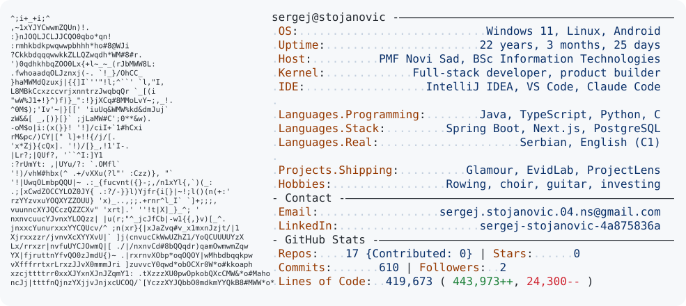

<a href="https://www.linkedin.com/in/sergej-stojanovic-4a875836a/">
  <picture>
    <source media="(prefers-color-scheme: dark)" srcset="dark_mode.svg">
    
  </picture>
</a>

### What I'm building

| | Project | What it is | Stack |
|---|---|---|---|
| 💇 | **[Glamour](https://github.com/Excapex/glamour-showcase)** | Multi-tenant booking & operations SaaS for salons. Built solo, now developed by a team of two; MVP-ready, with an embeddable booking widget. | Java 21 · Spring Boot · PostgreSQL · Next.js · Stripe |
| 🧪 | **[EvidLab](https://github.com/Excapex/evidlab-showcase)** | Lab inventory in pilot use at the PMF Novi Sad Departments of Chemistry and Biology since October 2026. I led a team of 3. [Website](https://evidlab.vercel.app) · [Live demo](https://evidlab-demo-web.onrender.com) | Spring Boot · React/TS · PostgreSQL |
| 🔥 | **[ProjectLens](https://github.com/Excapex/projectlens-showcase)** | AI copilot for reviewing fire-protection designs for building permits (formerly Saglasnik). Cuts one review from about 15 hours to about 20 minutes on real projects. Born at the Grok Bot Serbia Hackathon. | Python · FastAPI · React · LLMs |

Commercial products live in private repos. Each showcase repo has screenshots, architecture and the engineering decisions behind it. Happy to walk through the code on a call.

### Tools I ship with

  

### Right now
- 4th-year Information Technologies at PMF, University of Novi Sad
- Developer at a digital agency: websites, automations and SEO for real clients
- Level Up Academy (Digitalna Srbija × UNDP), first generation: entrepreneurship, product–market fit & UX, data analytics, advanced AI
- Open to internships and junior backend / full-stack roles

The card above is regenerated daily by a GitHub Action ([today.py](today.py)). Idea borrowed from [Andrew6rant](https://github.com/Andrew6rant).
